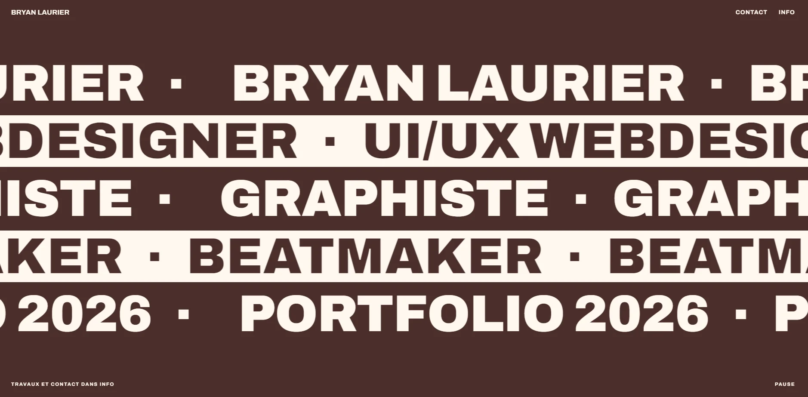
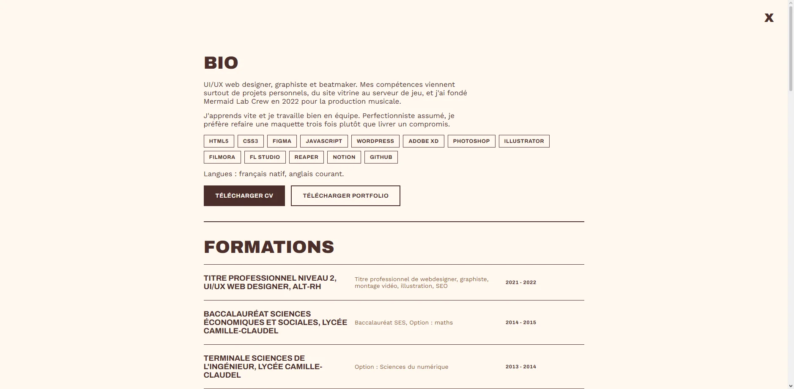
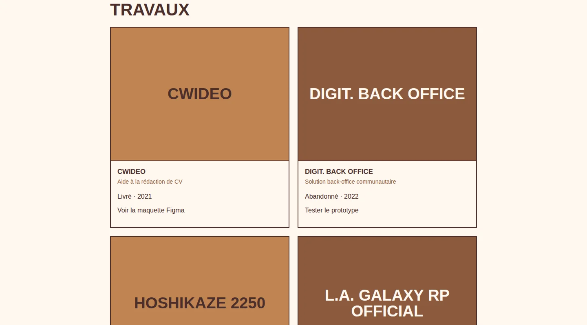

# Bryan Laurier : Portfolio

Portfolio personnel de Bryan Laurier, UI/UX Web Designer, graphiste et beatmaker.

Design inspiré de [monomono.studio](https://monomono.studio) : mur de texte plein écran en bandes défilantes (marquee), panneau "Info" en overlay plein écran, esthétique monochrome noir & blanc.

## Fonctionnalités

- **Mur de texte animé** : bandes de texte défilant en boucle (alternance gauche/droite, noir/blanc) présentant le nom et les activités de Bryan
- **Panneau Info** : overlay plein écran regroupant bio, formations, expériences, travaux (cartes avec visuel) et contact
- **Fenêtre "Projet indisponible"** : modale qui s'affiche quand un projet du portfolio n'est plus accessible en ligne, avec redirection vers le profil Behance
- **Responsive** : mise en page mobile, tablette et bureau
- **Accessibilité** : navigation clavier avec focus géré dans les fenêtres, calques fermés inertes, bouton pause du défilement, `prefers-reduced-motion` respecté

## Stack technique

- HTML5 / CSS3 (variables CSS, `clamp()`, Grid, animations `@keyframes`)
- JavaScript vanilla (aucune dépendance)
- Polices : [Archivo](https://fonts.google.com/specimen/Archivo) (titres) et [Work Sans](https://fonts.google.com/specimen/Work+Sans) (texte courant), via Google Fonts

## Structure du projet

```
template/index.html     gabarit de la page d'accueil
data/site.json         contenus modifiables
tools/build.py         génère le site
admin/                 back office
mentions-legales.html
404.html
sitemap.xml, robots.txt
@CSS/style.css
@JS/script.js          overlay, modales, marquee, pause
@JS/contact.js         email et téléphone assemblés côté navigateur
@RESSOURCES/travaux/   visuels des cartes de la section Travaux
cv.pdf                 à ajouter
```

## Back office

Les contenus (textes, couleurs, projets, liens) vivent dans `data/site.json`. Le fichier `template/index.html` est le gabarit de la page, et `tools/build.py` génère le site (dossier `_site`) à chaque envoi sur la branche `main`. Le build vérifie toutes les valeurs : une couleur ou une adresse invalide fait échouer la publication et l'ancienne version reste en ligne.

Le back office se trouve dans `/admin/`. Il modifie `data/site.json` et dépose les visuels de projets (recadrés en 1200 x 900, convertis en WebP) via l'API GitHub.

Mise en place, une seule fois :

1. Dans le dépôt : Settings, Pages, Source : **GitHub Actions**.
2. Supprimer l'ancien `index.html` à la racine (il est remplacé par `template/index.html`).
3. Créer un jeton : GitHub, Settings, Developer settings, Fine-grained tokens, limité à ce seul dépôt, permission **Contents : Read and write**.
4. Ouvrir `/admin/`, coller le jeton, modifier, puis Enregistrer et publier. Le site se met à jour en une à deux minutes. En cas d'échec, l'onglet Actions du dépôt donne la raison.

Le jeton reste dans l'onglet du navigateur et disparaît à sa fermeture. Activer l'authentification à deux facteurs sur le compte GitHub.

## Ajouter un visuel de projet

Déposer dans `@RESSOURCES/travaux/` une image WebP de 1200 x 900 px, moins de 150 Ko, nommée comme le projet : `lchs-sud-41.webp`, `toutaelle.webp`, `awaplaisir.webp`, `cwideo.webp`, `digit-back-office.webp`, `hoshikaze-2250.webp`, `la-galaxy-rp.webp`. Sans image, la carte affiche le nom du projet sur fond noir. Adapter ensuite le texte alternatif dans `index.html`.

## Icônes de compatibilité

Sur chaque tuile `<li class="card">` de `index.html`, ajouter `data-devices="desktop mobile"` (ou `desktop`, ou `mobile`) pour afficher les icônes écran et téléphone à côté du titre. Sans l'attribut, aucune icône.

## Utilisation Utilisation

Aucune installation nécessaire : c'est un site statique.

1. Cloner le dépôt
2. Ouvrir `index.html` dans un navigateur, ou déployer sur GitHub Pages

## Screenshot







## Contact

- [Instagram](https://www.instagram.com/laurierbryan/) · [Behance](https://www.behance.net/bryanlaurierdesign) · [YouTube](https://www.youtube.com/channel/UCAXXTwDyHZvUeDOBMpdrp1Q)
